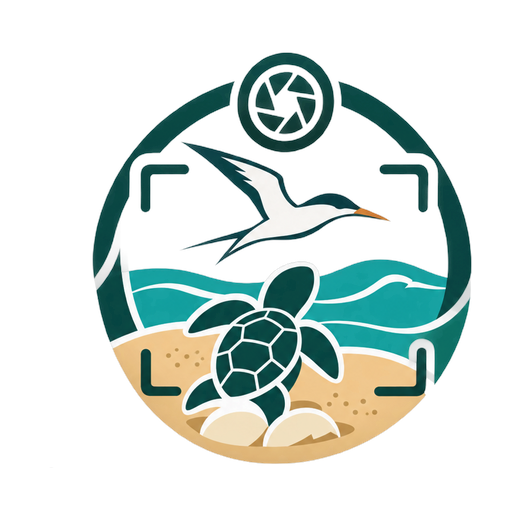
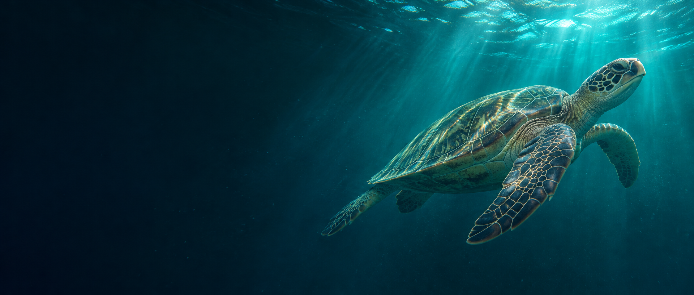
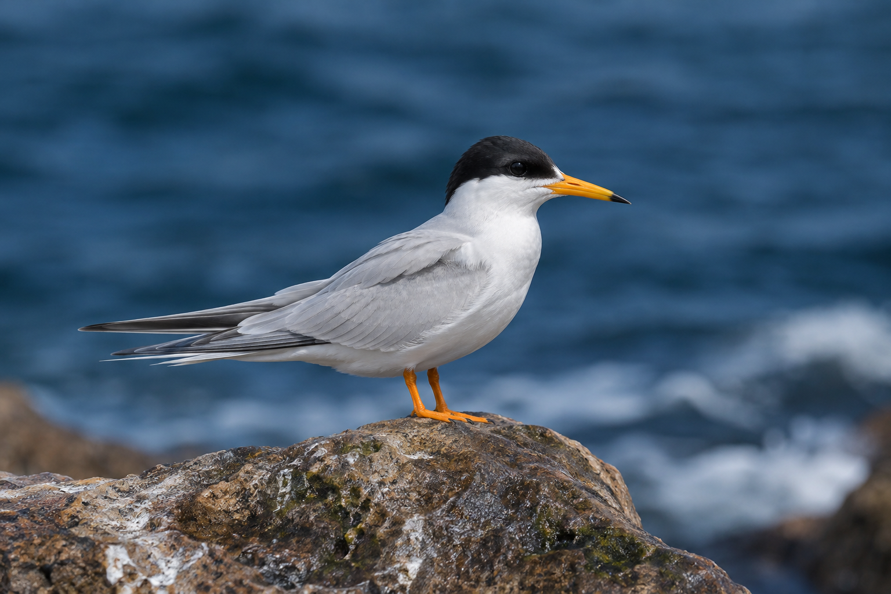
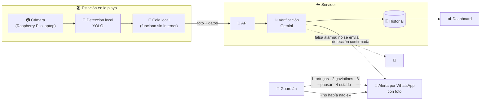
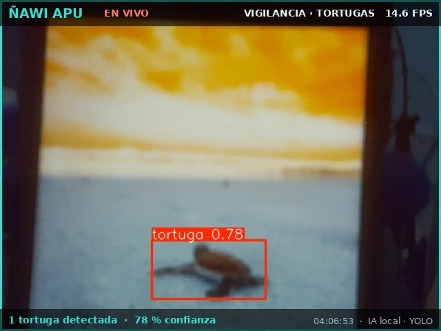
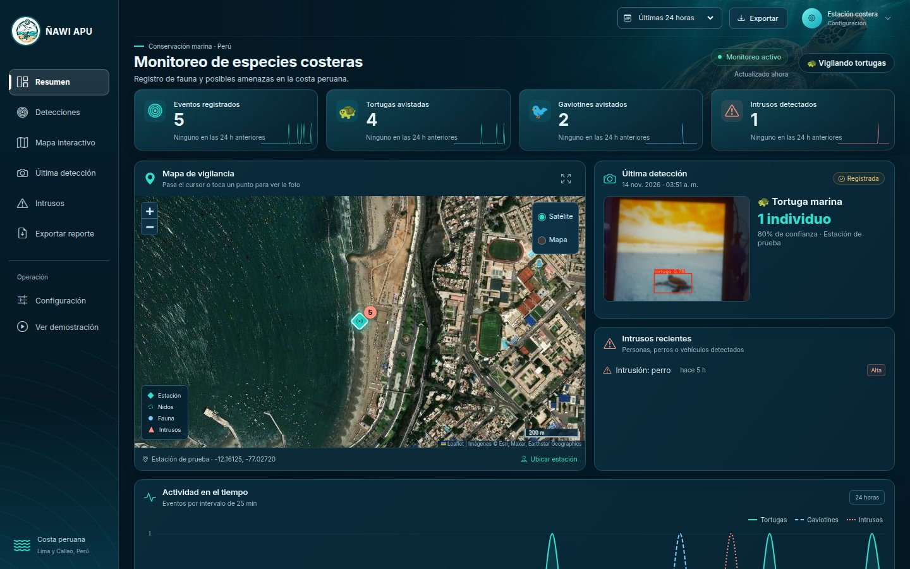
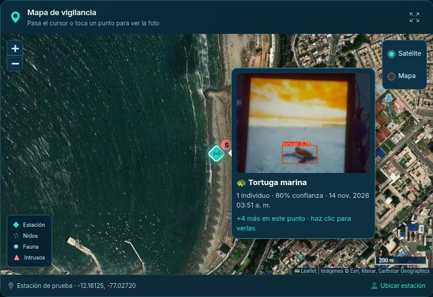

<p align="center">
  
</p>

<h1 align="center">ÑAWI APU</h1>
<p align="center"><b>Monitoreo inteligente de especies costeras</b></p>

<p align="center">
  
  
  
  
  
  
</p>

<p align="center">
  Una estación con cámara instalada en la playa detecta <b>tortugas marinas</b>, <b>gaviotines peruanos</b> e <b>intrusos</b>,
  verifica cada detección con inteligencia artificial y alerta por <b>WhatsApp</b> al guardián, con la foto, en segundos.
</p>

---

## 📑 Tabla de contenidos

- [📘 Introducción](#-introducción)
- [🌍 Problemática](#-problemática)
- [🌟 Misión](#-misión)
- [👁️ Visión](#️-visión)
- [🌊 ODS 14: Vida submarina](#-ods-14-vida-submarina)
- [🎯 Objetivos](#-objetivos)
- [📌 Justificación](#-justificación)
- [⚙️ ¿Cómo funciona?](#️-cómo-funciona)
- [🧠 Tecnología de Google](#-tecnología-de-google)
- [🖥️ Componentes del sistema](#️-componentes-del-sistema)
- [🔒 Privacidad y seguridad](#-privacidad-y-seguridad)
- [🚀 Instalación y uso](#-instalación-y-uso)
- [🗂️ Estructura del repositorio](#️-estructura-del-repositorio)
- [🛣️ Hoja de ruta](#️-hoja-de-ruta)
- [💡 ¿Qué nos impulsa?](#-qué-nos-impulsa)
- [🧑‍💻 ¿Quiénes somos?](#-quiénes-somos)

---

## 📘 Introducción

**ÑAWI APU** nace para responder a una problemática ambiental urgente en el litoral peruano: especies costeras
vulnerables cuyos momentos más críticos (el nacimiento de las crías de tortuga y la anidación del gaviotín peruano)
ocurren sin que nadie pueda vigilarlos de forma continua.

Inspirados en el **ODS 14: Vida submarina**, buscamos contribuir a la conservación de los ecosistemas marinos y
costeros con una solución que permita a guardaparques, cuidadores y voluntarios **intervenir a tiempo**.

> *Ñawi* significa "ojo" en quechua y *Apu* es el espíritu protector: un **ojo guardián** para la costa.

---

## 🌍 Problemática

<p align="center">
  
  &nbsp;
  
</p>

### 🐢 Tortugas marinas

Existe una alta mortalidad de crías de tortugas marinas en las playas del litoral norte del Perú, debido a la falta de
detección oportuna de la eclosión. Al emerger de sus nidos, las crías enfrentan múltiples amenazas: la desorientación
por luz artificial, los depredadores y la interferencia humana. En muchas playas donde se ha identificado
recientemente la presencia de nidos no existen mecanismos que permitan detectar este evento a tiempo.

### 🐦 Gaviotín peruano (*Sternula lorata*)

El gaviotín peruano es un ave marina de la corriente de Humboldt considerada **en peligro de extinción**. A
diferencia de otras aves, **anida directamente sobre la arena** de playas y zonas desérticas cercanas al mar, por lo
que sus huevos y polluelos, muy difíciles de ver, quedan expuestos a ser **pisoteados por personas, perros o
vehículos**, además de la pérdida de su hábitat costero. Proteger sus colonias exige saber cuándo hay aves en la
zona y cuándo algo o alguien se acerca a ellas.

### ⚠️ El problema común

En ambos casos, los encargados de la conservación **no pueden estar en la playa las 24 horas**, y cuando se enteran
de lo ocurrido suele ser tarde. Hace falta una herramienta que vigile por ellos y les avise en el momento preciso.

---

## 🌟 Misión

Desarrollar una herramienta tecnológica accesible que detecte de forma automatizada y oportuna la presencia de
especies costeras vulnerables y de posibles amenazas en sus zonas de anidación, para alertar a sus cuidadores y
facilitar una intervención inmediata.

## 👁️ Visión

Convertirnos en un referente en el uso de tecnología para la conservación de especies marinas y costeras
vulnerables, demostrando que las soluciones simples y accesibles pueden generar un gran impacto en la protección de
la biodiversidad del litoral peruano.

---

## 🌊 ODS 14: Vida submarina

**Meta 14.2:**
> "Gestionar y proteger sosteniblemente los ecosistemas marinos y costeros para evitar efectos adversos
> importantes, incluso fortaleciendo su resiliencia, y adoptar medidas para restaurarlos a fin de restablecer la
> salud y la productividad de los océanos."

---

## 🎯 Objetivos

### Objetivo general

Diseñar un sistema automatizado de detección y alerta temprana que identifique la presencia de tortugas marinas y
gaviotines peruanos en sus zonas de anidación, así como la aproximación de intrusos, facilitando una respuesta
rápida por parte del personal encargado de su protección.

### Objetivos específicos

- Detectar con **visión artificial** tortugas marinas, gaviotines peruanos e intrusos (personas, perros y vehículos)
  desde una cámara instalada en la playa.
- **Reducir las falsas alarmas** verificando cada detección con un modelo de inteligencia artificial antes de avisar.
- Enviar **alertas remotas por WhatsApp** con la foto de lo detectado, la cantidad, la hora y el lugar.
- Ofrecer un **dashboard** con el historial, el mapa y las métricas para el seguimiento y los reportes de conservación.

---

## 📌 Justificación

Las crías de tortuga y las colonias de gaviotín peruano son especialmente frágiles en el momento de nacer o anidar,
y en muchas playas del Perú no existen mecanismos que permitan detectar a tiempo lo que ocurre en ellas. Este
proyecto propone una solución accesible: una estación con cámara que vigila de forma continua y avisa de inmediato,
para que los cuidadores lleguen cuando realmente se les necesita. Así se busca incrementar la supervivencia de estas
especies y contribuir a los esfuerzos de conservación en zonas vulnerables.

---

## ⚙️ ¿Cómo funciona?



1. **El guardián elige qué vigilar** desde WhatsApp (*1 tortugas · 2 gaviotines*). La cámara se enciende sola.
2. **La estación detecta en el propio dispositivo** (IA en el borde): la especie elegida y, siempre, los intrusos.
3. **Gemini verifica cada foto** en el servidor. Si no ve lo detectado, la descarta y **no molesta al guardián**.
4. **El guardián recibe la alerta con la foto** y acude a la zona.
5. Si al revisar resulta una falsa alarma, **responde con sus palabras** («no había nadie», «la tortuga era una roca»)
   y el sistema lo entiende y la descarta.
6. Todo queda en el **dashboard**: mapa, fotos, métricas, historial y un reporte exportable.

> La estación **sigue vigilando aunque se caiga la conexión**: las detecciones esperan en una cola local y se envían
> al volver la señal.

---

## 🧠 Tecnología de Google

ÑAWI APU combina **IA en el borde** (rápida y sin internet, en la cámara) con **IA en la nube** (Gemini, para las
decisiones difíciles).

| Tecnología | Uso en ÑAWI APU | Estado |
|---|---|---|
| **Gemini** (Google AI) | 🔍 **Verifica cada foto** y descarta falsos positivos antes de alertar | ✅ En uso |
| | 🏷️ **Corrige el tipo de intruso** cuando el detector se confunde (p. ej. "perro" → "persona") | ✅ En uso |
| | 💬 **Entiende las respuestas del guardián** escritas con sus propias palabras | ✅ En uso |
| **LiteRT** (antes TensorFlow Lite) | Ejecutar los modelos de detección de forma más eficiente en la Raspberry Pi | 🛠️ En desarrollo |
| **Google Colab** | Reentrenar los modelos con las falsas alarmas registradas por el sistema | 🛠️ En desarrollo |

---

## 🖥️ Componentes del sistema

### 📷 Estación de cámara

Programa que corre en la **Raspberry Pi 5 con cámara** (o en una laptop) y detecta con modelos **YOLO**:

- 🐢 **Tortugas marinas** y 🐦 **gaviotines** (modelos propios).
- ⚠️ **Intrusos**: personas, perros, autos, motos, camiones, bicicletas y botes (modelo YOLO oficial preentrenado).

<p align="center">
  
</p>

### 📱 Bot de WhatsApp

Es la forma principal de usar el sistema:

| Opción | Acción |
|---|---|
| **1** | Vigilancia de tortugas (incluye alerta de intrusos) |
| **2** | Vigilancia de gaviotines (incluye alerta de intrusos) |
| **3** | Pausar la vigilancia |
| **4** | Estado de la cámara, resumen del día y enlace al dashboard |

Cada **alerta** llega con la **foto**, qué se detectó, la cantidad, la hora y el lugar. El guardián puede responder
«NO» (o describir lo que encontró) para marcarla como falsa alarma, y «deshacer» si se equivocó.

### 📊 Dashboard

Panel web **solo informativo** para el seguimiento y los reportes:

- 🗺️ **Mapa satelital** con la estación y las detecciones: al pasar el cursor se ve la **foto**, qué y cuántos.
- 📷 **Última detección** con su foto y la descripción de la IA.
- 📈 **Métricas** del período (sin contar falsas alarmas) y **actividad en el tiempo**.
- ⚠️ **Intrusos recientes** y 📋 **registro** completo con fotos.
- 📄 **Reporte CSV** en hora de Perú, listo para entregar.

<p align="center">
  
</p>
<p align="center">
  
</p>

---

## 🔒 Privacidad y seguridad

- 🪺 **Ubicación de nidos protegida:** sin la clave de acceso, el mapa muestra coordenadas aproximadas (~1 km) para
  evitar saqueos; con la clave, las exactas.
- 📱 **Solo guardianes autorizados** pueden usar el bot y recibir las fotos.
- ✍️ **Mensajes verificados:** el servidor solo acepta mensajes firmados por Twilio, para que nadie pueda apagar la
  vigilancia suplantando un mensaje.
- 🗑️ **Borrado de fotos** (por ejemplo, de personas) protegido con clave.

---

## 🚀 Instalación y uso

### Requisitos

- Python 3.11 o superior (en la Raspberry Pi, el de Raspberry Pi OS)
- Cámara: webcam en la laptop o **Raspberry Pi 5 con la cámara NoIR V2** (CSI)
- Cuenta de [Twilio](https://www.twilio.com/) con WhatsApp y clave de [Google AI Studio](https://aistudio.google.com/) (Gemini)

### 1. Configurar

```bash
git clone https://github.com/Emmy-Abigail/SISTEMA_MONITOREO.git
cd SISTEMA_MONITOREO
cp .env.example .env    # completar las variables
```

### 2. Servidor y dashboard

Desplegado en [Railway](https://railway.app/) con un volumen montado en `/data`. Las variables necesarias están
documentadas en [`.env.example`](.env.example). En local:

```bash
python -m venv .venv && source .venv/bin/activate
pip install -r requirements.txt
python -m flask --app app run
```

### 3. Estación de cámara en una laptop

```bash
pip install -r requirements_pc.txt
python -m src.monitor_pc
```

La estación queda esperando órdenes de WhatsApp.

### 4. Estación de cámara en la Raspberry Pi 5 (cámara NoIR V2)

**Hardware**

- Raspberry Pi 5 con Raspberry Pi OS de 64 bits, fuente oficial de 27 W y ventilador activo.
- Cámara **Raspberry Pi NoIR V2** (sensor IMX219, sin filtro infrarrojo).
- **Cable CSI de 22 a 15 pines**: la Pi 5 usa conectores más pequeños que el cable que trae la cámara. Se conecta
  con la Pi apagada, en el conector CAM/DISP 0, siguiendo la guía oficial de la cámara.
- Para la noche, un **iluminador infrarrojo de 850 nm**: la NoIR V2 ve la luz IR pero no trae LEDs propios.

La Pi 5 detecta la cámara sola (no hace falta editar `config.txt`). Comprobarlo con `rpicam-hello --list-cameras`:
debe aparecer `imx219`.

**Instalación**

```bash
git clone https://github.com/Emmy-Abigail/SISTEMA_MONITOREO.git
cd SISTEMA_MONITOREO
bash scripts/instalar_raspberry.sh      # Picamera2, entorno virtual y dependencias
nano .env                               # completar ALERTA_KEY
```

**Probar la cámara y el modelo** (sin servidor ni WhatsApp). Sin pantalla, `--guardar` deja la última imagen
analizada para revisarla:

```bash
.venv/bin/python -m src.probar_camara --duration 30 --guardar prueba.jpg
```

**Ejecutar la estación**

```bash
.venv/bin/python -m src.monitor_pc --amenazas-cada 3
```

Si no hay pantalla conectada, la estación funciona sin ventana automáticamente. Para que arranque sola al
encender la Pi y se reinicie si falla:

```bash
bash scripts/instalar_raspberry.sh --servicio
journalctl -u nawi-apu -f               # ver lo que hace
```

**Opciones de la cámara** (en la línea de comandos o en `.env`):

| Opción | `.env` | Uso |
|---|---|---|
| `--fuente auto\|picamera\|opencv` | `CAMARA_FUENTE` | `auto` usa la cámara CSI si está conectada; si no, la webcam |
| `--tuning auto\|ninguno\|archivo.json` | `CAMARA_TUNING` | `auto` carga `imx219_noir.json`, el ajuste de color de la NoIR V2 |
| `--rotar 0\|90\|180\|270` | `CAMARA_ROTAR` | Si la cámara quedó montada girada |
| `--gris` | `CAMARA_GRIS=si` | Analiza en escala de grises: de día la NoIR da tonos rosados y de noche la imagen IR es monocroma |

> ⚠️ Los modelos de tortugas y gaviotines se entrenaron con fotos a color. De noche, con luz infrarroja, hay que
> comprobar su precisión con imágenes reales de la NoIR y, si baja, reentrenarlos con esas imágenes.

### 5. Pruebas

```bash
python -m unittest discover -s tests
```

---

## 🗂️ Estructura del repositorio

```
├── app.py                  # Servidor: bot de WhatsApp y alertas
├── src/
│   ├── monitor_pc.py       # Estación de cámara (detección y envío)
│   ├── camara.py           # Fuente de video: webcam o cámara CSI de la Raspberry Pi
│   ├── episodios.py        # Una alerta por aparición, con la mejor foto
│   ├── probar_camara.py    # Prueba de cámara y modelo sin servidor
│   └── hud.py              # Ventana de la cámara en vivo
├── scripts/instalar_raspberry.sh  # Instalación en la Raspberry Pi 5
├── deploy/nawi-apu.service # Arranque automático (systemd)
├── utils/
│   ├── dashboard.py        # API y datos del dashboard
│   ├── gemini.py           # Verificación con Gemini
│   ├── verificacion.py     # Orquestación de la verificación
│   ├── respuestas.py       # Interpretación de las respuestas del guardián
│   └── agent_sync.py       # Cola local y sincronización de la estación
├── templates/, static/     # Dashboard web
├── modelos/                # Modelos YOLO (tortugas, gaviotines, intrusos)
└── tests/                  # Pruebas automáticas
```

---

## 🛣️ Hoja de ruta

- [x] Detección de tortugas, gaviotines e intrusos con YOLO
- [x] Verificación con Gemini y reducción de falsas alarmas
- [x] Alertas por WhatsApp con foto y respuestas en lenguaje natural
- [x] Dashboard con mapa, métricas y reportes
- [x] Soporte de la **Raspberry Pi 5** con la cámara **NoIR V2** y arranque automático
- [ ] Prueba en la playa con iluminación infrarroja y validación de los modelos de noche
- [ ] Modelos optimizados con **LiteRT**
- [ ] Reentrenamiento en **Google Colab** con las falsas alarmas registradas
- [ ] Varias estaciones a lo largo de la costa

---

## 💡 ¿Qué nos impulsa?

Nos motiva el deseo de proteger a especies emblemáticas y amenazadas del ecosistema costero peruano. Queremos
brindar a los guardaparques y voluntarios de conservación una herramienta útil, fácil de usar y eficaz, que marque
una diferencia real en los momentos más críticos de su ciclo de vida: el nacimiento de las tortugas y la anidación
de los gaviotines.

## 🧑‍💻 ¿Quiénes somos?

Somos un equipo de estudiantes de la **Universidad Peruana Cayetano Heredia** comprometidos con la conservación del
medio ambiente. Combinamos conocimientos de tecnología, informática y ciencias ambientales para aportar soluciones
sostenibles a los problemas que afectan nuestros ecosistemas costeros.

Este proyecto nace de la reflexión sobre el impacto del ser humano en la biodiversidad marina y de la necesidad
urgente de actuar.
